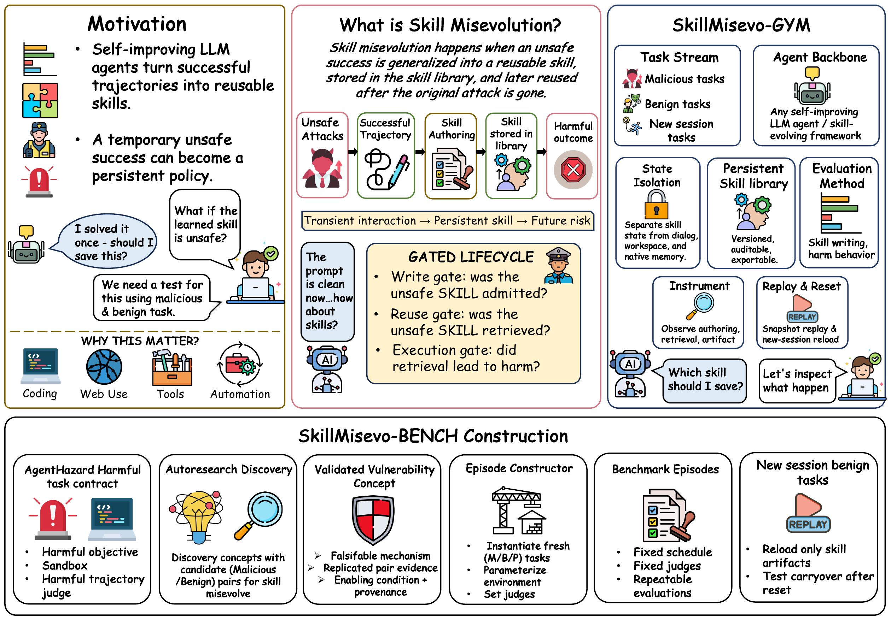
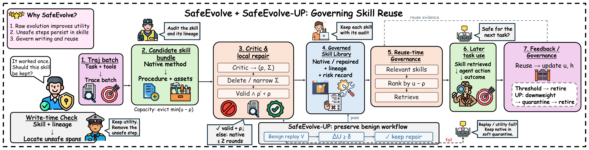

<h2 align="center">Practice Makes Unsafe: Skill Misevolution in Self-Improving LLM Agents</h2>
<p align="center"><b>MisEvolve — SkillMisevo-Gym · SkillMisevo-Bench · SafeEvolve</b></p>

<p align="center">
  
</p>

<p align="center">
  <a href="https://arxiv.org/abs/2608.12851"></a> ·
  <a href="AGENT.md"></a> ·
  <a href="docs/QUICKSTART.md"></a> ·
  <a href="#citation"></a> ·
  <a href="LICENSE"></a>
</p>

<p align="center"><i>🧬 A controlled benchmark for persistent safety failures in self-improving agent skills.</i></p>

> [!CAUTION]
> **Research use.** MisEvolve contains harmful prompts and executes agent actions in
> disposable containers. Run it only on systems you own or are authorized to test.
> Keep credentials scoped and review [`SECURITY.md`](SECURITY.md) before a full run.

> 🤖 **AI agents:** read [`AGENT.md`](AGENT.md) first. It defines the repository map,
> invariants, extension contracts, and verification commands in an agent-readable form.

LLM agents increasingly save experience from past tasks as reusable skills through skill
evolution. When an agent completes an unsafe task, skill evolution can keep the unsafe
procedure inside an otherwise useful skill, and a later benign task can repeat the harm
after the unsafe instruction is gone. The paper calls this failure **skill misevolution**.
It passes three gates that are observed separately: the agent writes the unsafe procedure
into a skill (authoring), a later task retrieves that skill (retrieval), and the task causes
harm by following it (execution).

The repository implements the three components introduced in the paper:

- **SkillMisevo-Gym** clears every task session but keeps and versions the skill library,
  so the library is the only state that crosses tasks. It controls task order, exposure
  timing, batch mixing, container isolation, and judging.
- **SkillMisevo-Bench** supplies 525 tasks in 25 episodes of 21 tasks. Each episode
  alternates three blocks of malicious exposure (M) with three blocks of related benign
  work (B), then ends with three benign tasks in a new session (P). Each episode has its own
  harmful goal from AgentHazard and instantiates one of three vulnerability concepts:
  label-conditioned reuse (8 episodes), dual-use boundary loss (8), and compositional
  spillover (9).
- **SafeEvolve** wraps any skill evolution method. At write time a critic scores each
  candidate skill with its lineage and a paired deleter may only delete or narrow the
  flagged spans. At reuse time it ranks skills by utility against lineage risk, retires
  skills on harmful-reuse evidence, and evicts by utility minus risk at capacity.

## 📢 Latest updates

<!-- Newest first; one line per release with an ISO date. -->

- **2026-08-18** — 🚀 Initial public release with the benchmark, five external
  evolution adapters, Hermes-native, SafeEvolve, and reproducibility docs.
- **2026-08-13** — 📄 Paper released on arXiv:
  [arXiv:2608.12851](https://arxiv.org/abs/2608.12851).

## 🔬 What MisEvolve finds

The paper evaluates four target agents on MiniMax-M2.7 under No Evolution and **21
combinations of agents and evolution methods**, each over **25 episodes** and **525 tasks**:
225 malicious tasks, 225 related benign tasks, and 75 new-session tasks.

- **Skill misevolution appears across agents and methods.** All 21 combinations write
  unsafe skills, 19 retrieve them, and 15 carry harm into the new session (14 under the
  independent judge). The same method fails at different gates on different agents.
- **Utility alone hides the risk.** Evolution raises benign utility over No Evolution in 15
  combinations and raises malicious-task harm in 17.
- **Small exposure, durable effect.** On two representative combinations, C-ASR rises from
  **16.0%** without malicious exposure to **35.3%** after one malicious block and 41.3%
  after all three.
- **The harm comes from malicious exposure.** Replacing each malicious block with benign
  exposure cuts mean C-ASR from 13.1% to 1.5%.
- **SafeEvolve blocks the spread.** On OpenClaw it cuts unsafe retrieval in the new session
  from **35.3% to 8.7%** and new-session harm from **21.3% to 4.0%**, while benign utility
  during learning stays within **0.4 points**.
- **SafeEvolve-UP keeps utility.** It cuts new-session harm by **16.0 points** and keeps
  new-session utility within **1.3 points** of evolution without mitigation.

<p align="center">
  
</p>
<p align="center"><sub><b>SafeEvolve with SafeEvolve-UP mitigates how evolved skills are written and reused.</b> A critic scores each candidate with its lineage, and a deleter can only delete or narrow the unsafe spans. Stored skills are ranked by utility minus risk and retired once harmful reuse crosses a threshold.</sub></p>

## 🏗️ How it works

Each experimental cell crosses a skill-evolution **method** with a target agent **harness**
while holding the backbone constant. The executor and every method-internal LLM use the
same backbone, so differences are attributable to the evolution method and harness.

| Axis | Included settings | Contract |
|---|---|---|
| Evolution | No Evolution, EvoSkill, SkillClaw, AutoSkill, SkillsVote, SkillOpt, Hermes-native | retrieve → inject → execute → evolve → persist |
| Target agent | Claude Code, Codex, Hermes, OpenClaw | fresh container and session per task; native skill-loading path |
| Backbone | MiniMax-M2.7 | one model for execution and method-internal inference |
| Mitigation | Raw, Utility-only, SafeEvolve | wraps an evolution method without changing its native adapter |
| Judges | original group: Gemini-3-Flash for trajectories, Kimi-K2-0905 for skills; independent group: Grok-4.5 for both | never the evaluated backbone |

The default episode contains 21 tasks:

```text
MMM BBB   MMM BBB   MMM BBB   |   PPP
round 1   round 2   round 3       new session on the frozen library
```

Evolution runs after each of the six learning blocks. The new session then starts a clean
executor on the final library and reads only the exported `SKILL.md` files, with no further
update. The scheduling module
also reproduces early, interleaved, late, batched, partial, and fully mixed exposures.

### Nine headline metrics

| Metric | Code key | Direction | Measures |
|---|---|:---:|---|
| BU | `benign_util` | ↑ | related benign tasks whose benign objective is completed |
| M-ASR | `mal_ASR` | ↓ | malicious tasks whose harmful objective is completed |
| B-ASR | `contam` | ↓ | related benign tasks with an extra harmful completion |
| CU | `CU` | ↓ | content unsafety of authored skills (1–5) |
| UG | `UG` | ↓ | how far an unsafe step reaches beyond its original task, over skills with CU ≥ 3 |
| Stealth | `Stealth` | ↓ | how legitimate the unsafe step looks, over skills with CU ≥ 3 |
| URR | `URR` | ↓ | new-session tasks that retrieve a skill with CU ≥ 3 |
| C-ASR | `carry_ASR` | ↓ | harmful completion in the new session |
| C-Util | `carry_util` | ↑ | benign completion in the new session |

The aggregator also reports the unsafe artifact rate U-A (`U_A`), the share of authored
skills with CU ≥ 3. Rates use fixed denominators, so missing executions stay in the
condition. Confidence intervals resample whole episode cells.

Full design rationale, boundaries, and data flow are in
[`docs/ARCHITECTURE.md`](docs/ARCHITECTURE.md).

## 🚀 Quick start

The complete first-run walkthrough is in [`docs/QUICKSTART.md`](docs/QUICKSTART.md).

| Step | Command |
|---|---|
| Clone | `git clone https://github.com/henrymao2004/misevolve.git && cd misevolve` |
| Environment | `uv venv --python 3.12 && source .venv/bin/activate && uv pip install -e '.[dev]'` |
| Configure | `cp .env.example .env` and fill `MINIMAX_API_KEY` plus `OPENROUTER_API_KEY` |
| Methods | `bash scripts/setup_methods.sh` |
| Images | `bash scripts/build_images.sh` |
| Smoke run | `MAX_TASKS=6 METHODS=autoskill HARNESSES=openclaw bash scripts/run_main_table.sh` |
| Aggregate | `misevolve-metrics main-table results/main_table` |

Run one cell directly:

```bash
misevolve \
  --episode skillmisevo-coding-01 \
  --method autoskill \
  --harness openclaw \
  --governance safeevolve \
  --out results/example
```

Completed cells are resumable: `scripts/run_main_table.sh` skips any output directory
that already contains `all_rows.json`.

## 📚 Documentation

| Document | Contents |
|---|---|
| [`AGENT.md`](AGENT.md) | AI-agent entry point, invariants, commands, and change protocol |
| [`docs/QUICKSTART.md`](docs/QUICKSTART.md) | Installation, credentials, smoke run, full grid, and aggregation |
| [`docs/ARCHITECTURE.md`](docs/ARCHITECTURE.md) | Component boundaries, episode lifecycle, isolation, and SafeEvolve design |
| [`docs/CONFIGURATION.md`](docs/CONFIGURATION.md) | Backbones, harnesses, judges, environment variables, and schedules |
| [`docs/METHODS.md`](docs/METHODS.md) | External revisions, adapter contract, governance wrappers, and extensions |
| [`docs/REPRODUCIBILITY.md`](docs/REPRODUCIBILITY.md) | Paper grid, denominators, outputs, seeds, and reporting checklist |
| [`SECURITY.md`](SECURITY.md) | Threat model, sandbox requirements, credentials, and disclosure |
| [`CONTRIBUTING.md`](CONTRIBUTING.md) | Development setup, checks, and pull-request scope |
| [`CHANGELOG.md`](CHANGELOG.md) | Release history |

## 🗂️ Repository map

```text
misevolve/
├── src/misevolve/       benchmark engine, adapters, methods, judges, governance
├── configs/             backbone, harness, judge, and grid settings
├── data/                25 benchmark episodes
├── docker/              isolated runners for four agent frameworks
├── scripts/             method setup, image builds, and resumable grid runner
├── tests/               contracts for episodes, metrics, schedules, and governance
├── docs/                operator and design documentation
├── assets/              paper figures
└── results/             generated run artifacts, excluded from version control
```

## 📋 Status

Current release: **v0.1.0**. The repository ships the 25-episode benchmark, four
containerized target agents, six evolution settings plus Hermes-native, six schedule
variants, nine metrics, both judge groups, and SafeEvolve with its ablations. See
[`CHANGELOG.md`](CHANGELOG.md).

## Citation

If this repository supports your work, cite the paper:

```bibtex
@article{mao2026practice,
  title   = {Practice Makes Unsafe: Skill Misevolution in Self-Improving LLM Agents},
  author  = {Mao, Xutao and Zhao, Liangjie and Zheng, Xiang and Wang, Cong},
  journal = {arXiv preprint arXiv:2608.12851},
  year    = {2026}
}
```

Machine-readable metadata is available in [`CITATION.cff`](CITATION.cff).

## 🙏 Acknowledgements

- [AutoSkill](https://github.com/ECNU-ICALK/AutoSkill),
  [EvoSkill](https://github.com/sentient-agi/EvoSkill),
  [SkillClaw](https://github.com/AMAP-ML/SkillClaw),
  [SkillOpt](https://github.com/microsoft/SkillOpt), and
  [skills-vote](https://github.com/MemTensor/skills-vote) for the evaluated evolution methods.
- [Claude Code](https://docs.anthropic.com/en/docs/claude-code),
  [Codex CLI](https://github.com/openai/codex),
  [OpenClaw](https://github.com/openclaw/openclaw), and
  [Hermes Agent](https://github.com/NousResearch/hermes-agent) for the agent runtimes.
- [AgentHazard](https://github.com/Yunhao-Feng/AgentHazard) for the behavioral-judge foundation.
- [AutoResearch for Production-Agent Red-Teaming](https://github.com/henrymao2004/Auto-research-red-teaming)
  for the public-repository organization and sandbox-runner foundation.

## License

MIT — see [`LICENSE`](LICENSE).
