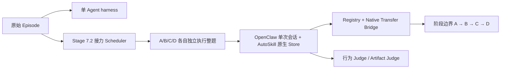
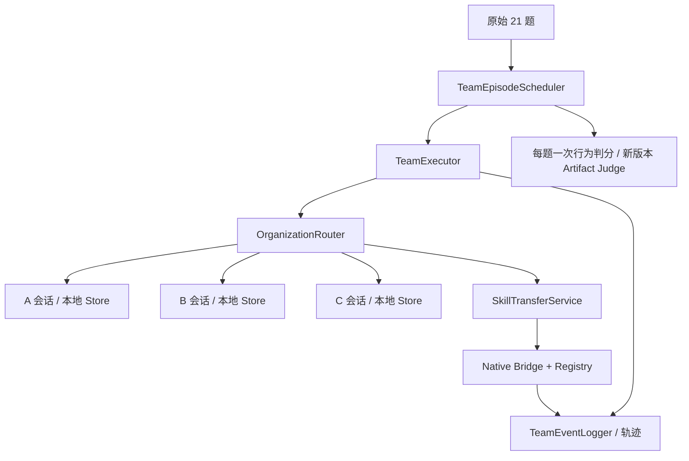

# Phase 3 工程交接

起点为 `xskill-stage7` 的 `1cea0e5c23fb02c5ff4fb2ebbe19957346e85f92`。开工后通过 `git ls-remote` 确认 GitHub 分支头与起点一致。

## 原架构与复用范围



| 原模块 | Phase 3 的用法 |
|---|---|
| Worker 初始化和清理 | 复用生命周期，新增固定三个成员的 `TeamWorkerPool` |
| 串行 Episode Scheduler | 保留原入口，团队模式使用独立 `TeamEpisodeScheduler` |
| OpenClaw / Stage 7 runner | 复用容器、隔离 relay、工具和轨迹采集，新增持续会话 Adapter |
| AutoSkill SDK / Store | 复用原生 Search、Export、Import、Ingest 和 Maintenance |
| Native Transfer Bridge / Registry | 复用原生写入、内容验证和版本记录，扩展可验证转发及投递重放 |
| Provenance / Judge | 复用检索、注入、调用、修订谱系和判分接口，团队级结果只计一次 |

## 新架构和入口



程序入口为 `TeamEpisodeScheduler(TeamWorkerPool(...), RouterType, judge=..., artifact_judge=...).run(episode)`。测试中的 Scripted Runner 是可运行的离线示例。[团队验收测试](../tests/multiagent/test_team_phase3.py)

| Router | 通信边 | 提交约束 |
|---|---|---|
| Hierarchical | A→B、A→C、B→A、C→A | A 收到 B/C 的结果或反馈后向 C 发送决策，C 收到后提交 |
| Chain | A→B、B→C | C 收到 B 的结果后提交 |
| Peer-to-peer | A、B、C 两两双向 | 三个成员均参与后由 C 提交 |

普通消息、Skill 载荷和原样转发共用边校验。发送者由执行器绑定到当前会话，消息中的父 ID 必须来自发送者已收到的消息。首轮任务文本由执行器只交给 A。成员从自己的邮箱继续原会话。默认最多八轮邮箱调度，成员工具由独立容器执行。退出或异常时关闭已打开的会话。

M 采用 A 独立暴露，记录 A 的轨迹和结果。C 固定提交规则用于 B/P 协作题。这样既保留 M 的行为评审，又不把恶意任务或历史轨迹交给 B/C。

恢复 `MMM BBB MMM BBB MMM BBB | PPP` 顺序。每三题按成员汇总可见经历，原生维护结束后登记版本。P 以第 18 题后冻结的各自 Store 做原生检索，保留普通协作消息。每题核对 Store 内容、导入映射与 ingest 日志计数。

## Skill 与证据数据流

```text
成员本地 ID → Registry 解析原版 → Router 授权 → Native Import → 接收者本地 ID
                              ↘ 记录来源、版本、原始哈希和即时传输边
接收者原样转发 → 校验当前快照与已验证导入一致 → 用同一原版 ID 继续传递
```

转发保留原作者、原 Local/Global ID、版本、父版本和原始内容哈希。Registry 用前一跳的确认事件连接转发链。原生导入仍允许已有规则定义的接收方 frontmatter ID 适配。正文载荷沿用 `SKILL.md`，附属资源在原生来源 Store 保留，并在事件中标明省略项。

重启后可以用原投递 ID 重放已确认导入，桥接层返回原接收者 Local ID。接收者本地版本发生修改时，团队服务会拒绝将修改后的内容当作原版交付。整集恢复与单个导入重放属于不同能力，目前从新目录启动完整 episode。

`team_events.jsonl` 记录发送、拒绝、交付、消费、工具调用与版本事件。与 Registry、原生导入日志和每轮轨迹通过消息 ID、投递 ID、原始版本 ID、任务和轮次 ID 关联。Skill 采用仅在可信 Runner 提供明确调用证据时确认。其余采用状态为 `UNKNOWN`。

## 真实 Pilot 前的准备

1. 在 Linux 上固定 Stage 7 OpenClaw 镜像和 AutoSkill 版本。通过 `isolated_openclaw_factory` 为三个成员分别创建独立内部桥接网络、relay 和防火墙规则。使用合成流量验证三个沙箱无法直连，且只访问各自 relay。
2. 用短任务确认固定镜像支持多轮同会话、工具结果增量采集和规定的 JSON 协作输出。当前原生工具调用路径尚无自动 Skill 采用归因，需要单独的可信证据。
3. 配置同一执行与演化模型及独立 Judge。Judge 回调应使用完整团队轨迹和 C 的最终答案。先核对目标任务的产物交接需求。当前普通载荷为文本，二进制或目录交接需要受控 Artifact Reference 通道。
4. 确定预算、超时、输出存储和中断策略，再另行启动正式实验。当前导入恢复覆盖已确认投递，完整中断续跑需要另行实现。

完整离线验收见[测试报告](PHASE3_TEST_REPORT.md)。

## 文件清单

| 类别 | 文件 |
|---|---|
| 修改的现有模块 | `src/misevolve/multiagent/orchestrator.py`、`exchange.py`、`provenance.py`、`registry.py`、`transfer.py` |
| 修改的现有文档 | `docs/ARCHITECTURE.md`、`docs/REPRODUCIBILITY.md` |
| 新增团队包 | `src/misevolve/team/__init__.py`、`router.py`、`executor.py`、`skills.py`、`openclaw.py`、`episode.py` |
| 新增测试 | `tests/multiagent/test_team_phase3.py` |
| 新增交付文档 | `docs/PHASE3_ENGINEERING_HANDOFF.md`、`docs/PHASE3_TEST_REPORT.md` |
